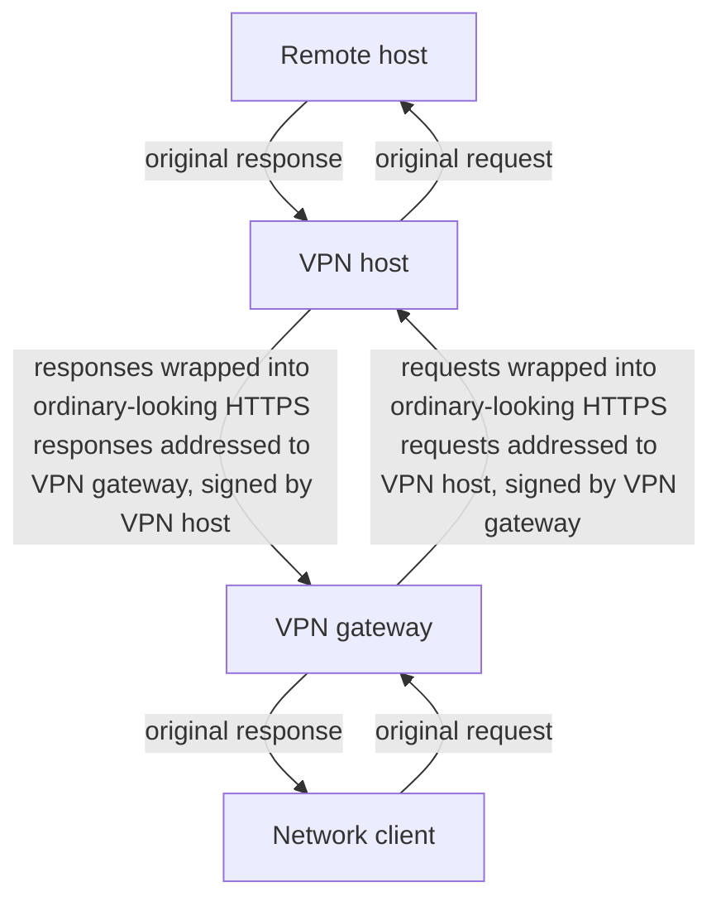

# RaspberryPi4bVpnGateway
Guide on building a VPN gateway on Raspberry Pi 4b.

## The problem
Whether I needed to access resources within some on-premise network, access resources that happened to be blocked in a given location, or break out of an overly aggressive firewall for purposes of research and information gathering, I often found myself in need of a VPN. Sometimes, internet providers or local network operators (in hotels, for example) would cut off communications over specific protocols, like OVPN or IPsec, even cut off all UDP traffic. On occasion, I was also unable to install the software which could provide the most secure tunnelling out of such constrained circumstances on the computers I was operating due to restricted permissions or due to mandatory antivirus software falsely identifying things as malware (this can happen with programs that create virtual interfaces, intercept network traffic, and the like). Running into such difficulties regularly over time, I determined to find a reliable solution that gave me control over the network traffic. Following is the description of how it works and how to construct it.

## Solution principles
To solve the problem, I wanted a device that acts as a middleman between the network to which I am connected and the machine which I am connecting to the network. I wanted this device to act like a network gateway for my machine, but instead of simply forwarding the network traffic to the infrastructure laid out by the network operator, I wanted my device to wrap this traffic into requests which look like ordinary encrypted HTTPS traffic, and forward it to an address that looks like an ordinary web destination that can be reasonably expected to conduct massive amounts of traffic continuously over HTTPS. Luckily for me, I did not have to develop my own networking protocol for this, because it already exists. I wanted this simple scheme of operation:

All traffic gets disguised, regardless of the traffic's native protocol. With this, I could even disguise other VPN protocols within this tunnel.

## How to get that done
I chose Raspberry Pi 4b as an easily accessible platform that has a native ethernet interface and can easily support adding a second ethernet interface or even wi-fi. My bill of materials is simple:

- Raspberry Pi 4b
- Waveshare USB 3.2 Gen1 HUB gigabit ETH HAT
- USB C cable for power
- 2x ethernet cable
- Short shielded USB 2.0 or better (I used USB 3.2) male A to male A cable
- High quality SD card of at least 4GB capacity.

The ethernet cable category doesn't matter, we're not even going to reach gigabit speeds with this configuration. If you wish to get up to Gigabit, you'll need to shell out for a Raspberry Pi 5 due to issues that I will discuss later.

### Connecting all the hardware
Once all the hardware is acquired, we need to connect the HAT to the Pi mainboard - attach the standoffs to the main board, connect the HAT interface, and secure it on the standoffs.
Then, connect the Waveshare board's USB HUB input port to Raspberry Pi 4b's black USB 2.0 interface that is the closest to the board itself. Use a short, shielded USB cable with good build quality.

We will be routing network traffic continuously through both the Pi native ethernet interface and the Waveshare ethernet interface. If we use the USB 3.2 rigid bridge that's provided with the Waveshare HAT, we will run into a serious stability problem - the bridge itself being unshielded will inevitably catch EM interference and introduce jitter into the USB signals. The USB controller on the Raspberry Pi 4b itself, the VL805 controller, has strict timing constraints and is implemented without the error recovery padding, making it highly susceptible to slightest electrical noise. Using this via the USB 3.2 rigid bridge, or even with a good quality USB cable connected over USB 3.2, I constantly ran into hard driver lockup on the Waveshare ethernet interface after as little as 100MiB of traffic transmitted. Having to restart the interface after every 100MiB of traffic was completely unacceptable to me. This problem is solved by connecting the Waveshare board's USB HUB input port to the black USB 2.0 interface on the Pi 4b that is closest to the board itself (there are two stacked on top of each other). USB 2.0 operates at a much lower frequency than the 2.5GHz of USB 3.2 and has much less strict signal timings. But the potential transmission speed will be significantly lower than the nominal 1 Gb of the network port. I don't even think it's likely one could reach the nominal USB 2.0 bandwidth of 480Mb.

If you are adamant on providing gigabit ethernet over such a device, you will need Raspberry Pi 5 as the base. That platform uses the RP1 south bridge I/O controller chip that was designed in-house for the Pi platform. It leverages PCIe 2.0 x4 link and two XHCI host controllers. The bandwidth of this configuration will be significantly higher and the hardware-level prioritization of QoS packets promises good stability.

Flash the DietPi OS on the SD card using any valid installation method prescribed by official DietPi documentation and insert the card into the Raspberry Pi board.

### Software installation
